# KIHACHI MUSIC AI
# System Architecture

Version: 1.0

Status: Living Document

---

# Studio integration (current implementation)

制作画面・CLI・MCP は同じアプリケーション層を共有します。制作ロジックの正本は kihachi-mcp です。

```
 制作画面 (static/index.html)   kihachi CLI (cli.py)   MCP tools (tools/studio.py)
            │ HTTP /api/*              │ Live系はStudio HTTP経由   │
            └──────────────┬───────────┴───────────────────────────┘
                           ▼
                  StudioRuntime (services/studio_runtime.py)
     generate · projects · review · revise(提案→採用) · approve · dry_run · send · verify
     settings · diagnostics
                           │
   ┌──────────┬────────────┼─────────────┬───────────────┬──────────────────┐
   ▼          ▼            ▼             ▼               ▼                  ▼
 AIProvider  brief/       midi_candidate production_     live_execution_   studio_workflow
 (Ollama /   interpreter  _builder       review/revision service + gate    (状態語・読み戻し比較・
 deterministic)(修復/再試行)(ジャンル別MIDI)(同じしきい値)  (1回だけ実行)     設定・一覧)
                                                         │
                                         Max for Live device (UDP 17771/17772)
                                         AbletonGPT Remote Script (TCP 9877, 任意)
```

- AIProvider は `health` / `list_models` / `generate` / `generate_structured` / `capabilities` を持ち、設定（画面保存 → 環境変数 → 既定値）から選びます。
- Live への書き込みは「承認 → ドライラン → 1回だけ送信 → 読み戻し比較」の順だけです。期待値（トラックごとのクリップ数・ノート数）は送信前に `<id>.expected.json` に保存し、再起動後も検証できます。
- 修正は子候補を作る提案で、採用するまで親候補は変わりません。履歴は `.kihachi-revisions.json`。
- Astra の作曲結果は `MusicPlan`（`kihachi.music_plan.v1`）です。Live へ出すときは既存の `LiveMutationPlan` に変換し、承認前には送りません。対応表は `docs/ASTRA_MUSIC_PROTOCOL.md` です。

## Reference analysis to Live production flow

Reference audio analysis provides abstract, reusable production constraints (for example tempo range, rhythmic density, swing, section energy, and accent patterns). It must not copy a reference's note sequence. The analysis card is input to candidate generation; it is not approval to mutate Live.

```mermaid
flowchart LR
    A[User selects reference] --> B[Reference library]
    B --> C[Reference analysis service]
    C --> D[Analysis card<br/>tempo, key, groove, density, sections]
    D --> E[Production pipeline]
    E --> F[SongSpec / MusicPlan]
    F --> G[Editable MIDI candidates]
    G --> H[Review and compare]
    H --> I[Human selects candidate]
    I --> J[Live state inspection]
    J --> K[Mutation plan and dry run]
    K --> L[Explicit approval]
    L --> M[Single execution]
    M --> N[Readback comparison]
    N --> O{Expected state matches?}
    O -->|yes| P[Verified receipt]
    O -->|no| Q[Stop and report discrepancy]
    P --> R[Editable Ableton Live Set]
```



### Data and safety boundaries

- The analysis card records its source reference and measured or inferred fields; uncertainty must remain visible to downstream generation and review.
- Reference-derived rules guide new material but do not authorize note-for-note copying or Live writes.
- Generation and effect suggestions remain candidates until reviewed. A card or pipeline run alone is not evidence that a device, parameter, or sound was applied in Live.
- Live changes follow the existing approval, dry-run, single-execution, and readback contract. A mismatch or unavailable readback is not `verified` and must not trigger automatic retry.
- Reports distinguish generated plans, attempted operations, readback-confirmed state, and human audition. Only the last establishes musical acceptance.

The user-provided execution log describes a HOUSE 129.2 BPM / D minor analysis card and a claimed 64-bar, seven-part production. That log is a report, not independent evidence of the current Live Set. Verify the current Set and readback before describing those values or effects as applied.

---

# Overview

KIHACHI MUSIC AI is composed of independent MCP services.

Each MCP has a single responsibility.

Communication happens through shared domain models.

```
                    User
                      │
                      ▼
              Orchestrator MCP
                      │
    ┌─────────────────┼──────────────────┐
    ▼                 ▼                  ▼
 Brain MCP       Memory MCP        Review MCP
    │                 │                  │
    ▼                 │                  ▼
 SongSpec             │          ReviewResult
    │                 │
    ▼                 ▼
 Ableton MCP     Knowledge Store
    │
    ▼
 Live Mutation Planner
    │
    ▼
 Approval Gate
    │
    ▼
 Max for Live / Live Object Model
    │
    ▼
 Editable Live Set
```

---

# Design Principles

## Single Responsibility

Each MCP owns one responsibility.

Brain thinks.

Ableton builds.

Memory remembers.

Review evaluates.

Orchestrator coordinates.

---

## Loose Coupling

Modules communicate only through shared models.

Never import another MCP's internal implementation.

Communication occurs via public interfaces.

---

## Shared Domain Models

All MCPs share common models.

Examples

- SongSpec
- TrackSpec
- Arrangement
- ProjectPlan
- ReviewResult

These models define the platform language.

---

# Layered Architecture

```
Presentation
    ↓
MCP Tools
    ↓
Brain Facade
    ↓
Services
    ↓
Domain Models
    ↓
Infrastructure
```

---

## Presentation Layer

FastMCP tools

Responsibilities

- receive requests
- validate inputs
- call services
- return responses

Business logic is forbidden.

---

## Service Layer

Contains application logic.

Examples

- KnowledgeService
- GenerationService
- SongService
- ProjectService
- ReviewService
- MemoryService
- AbletonService
- LiveStateInspector
- LiveMutationPlanner
- ApprovalGate
- LiveExecutionService
- ArrangementExpander

---

## Domain Layer

Contains pure data structures.

No FastMCP dependency.

No filesystem dependency.

No network dependency.

---

## Infrastructure Layer

Responsible for

- filesystem
- localhost-only Ableton Live bridge (`127.0.0.1`, session token, size and time caps)
- AbletonGPT Remote Script socket (`127.0.0.1:9877` only)
- Max for Live device transport
- database

The MCP HTTP gateway (`kihachi serve --transport streamable-http`) is another
presentation entry on the same FastMCP server. It binds to `127.0.0.1` and
requires a bearer token. It does not open the Ableton socket to the network.
Public clients reach it through a tunnel that terminates TLS in front of that
loopback port. See [MCP_GATEWAY.md](MCP_GATEWAY.md).

There are no external API boundaries. Google Lyria is removed; KIHACHI generates
no audio.

---

# MCP Responsibilities

## Brain MCP

Produces

- SongSpec
- Arrangement
- Track Plans

Never renders audio.

---

## Ableton MCP

Produces

- Ableton Project
- MIDI
- Device Chains
- Track Routing

Never decides composition.

---

## Audio generation

There is none. KIHACHI generates no audio.

Google Lyria was removed in [ADR-0006](adr/0006-ableton-live-automation.md)
because a finished audio file is not an editable production artefact. The
deliverable is a Live Set whose MIDI, devices, and arrangement the user can
change. ACE-Step is not a runtime provider either.

Audio comes out of Ableton Live, rendered by the user from the Set KIHACHI
built.

---

## Review MCP

Produces

- Scores
- Comments
- Suggestions

Never modifies projects.

---

## Memory MCP

Stores

- successful songs
- failed songs
- reusable knowledge

---

## Orchestrator MCP

Coordinates every MCP.

Responsibilities

- workflow
- retries
- scheduling
- state management

---

# Data Flow

```
User
    ↓
Brain
    ↓
SongSpec
    ↓
ProjectPlan / MidiPlan
    ↓
LiveStateInspector          reads Live, changes nothing
    ↓
LiveMutationPlanner         builds an inert plan
    ↓
ApprovalGate                human approval, plan_hash binding, idempotency
    ↓
LiveExecutionService        applies an approved plan exactly once
    ↓
localhost bridge            127.0.0.1 only
    ↓
Max for Live device         Live Object Model
    ↓
Session View                patterns
    ↓ verification
Arrangement View            expansion of verified patterns only
    ↓ readback
Verified Execution Receipt
    ↓
Review → Memory → Knowledge → Brain
```

The feedback loop enables continuous improvement.

Two boundaries carry the safety weight.

A `LiveMutationPlan` is inert data. Holding one changes nothing. It records the
`set_fingerprint` it was planned against, so if the Set moved between planning
and execution the predicted track and scene indices are known to be stale and
execution stops.

A `LiveExecutionReceipt` never overclaims. `verified` requires that every
attempted operation was applied *and* read back matching its
`expected_readback`. `partially_applied` and `verification_failed` are distinct
outcomes that a human must resolve; neither is completion.

KIHACHI generates no audio. The deliverable is an editable Live Set.

---

# Repository Layout

```
src/
    kihachi_mcp/
        models/
        services/
        tools/
        shared/

tests/

docs/
```

Implementation lives under `src/kihachi_mcp/` ([ADR-0001](adr/0001-use-src-layout.md)). The repository root keeps `server.py` as a compatibility entry point.

---

# Coding Rules

- Use dataclasses for domain models.
- Prefer dependency injection.
- Avoid global state.
- Use type hints everywhere.
- Keep functions small and focused.
- Write unit tests before integration tests.

---

# Testing Strategy

```
Unit Tests
    ↓
Service Tests
    ↓
Integration Tests
    ↓
End-to-End Tests
```

---

# Documentation Strategy

Every feature requires

- Issue
- ADR (if architecture changes)
- Tests
- Changelog

---

# Future Expansion

Future MCPs

- MIDI Generator
- Lyrics Generator
- Stem Separator
- Mastering
- Mixing
- Publishing
- Streaming
- Analytics

The architecture should allow adding new MCPs without changing existing ones.

---

# Success Criteria

The platform can

Think

↓

Plan

↓

Build

↓

Generate

↓

Review

↓

Learn

↓

Improve

↓

Repeat

without breaking modularity.

---

# Current Brain MCP (this repository)

This repo is the Brain plus the Ableton Live automation boundary ([ADR-0006](adr/0006-ableton-live-automation.md)). There is no audio generator: Google Lyria is removed.

Public tools (17): `hello`, `generate_songspec`, `create_project_from_songspec`, `create_ableton_plan`, `create_midi_plan`, `prepare_ableton_handoff`, `inspect_live_state`, `live_device_catalogue`, `create_live_mutation_plan`, `request_live_execution`, `execute_live_request`, `verify_live_execution`, `expand_session_to_arrangement`, `review_songspec`, `remember_song`, `search_memory`, `orchestrate_song`. Details: [API.md](API.md).

Every Live mutation stays behind the human approval boundary. `save_live_set` is not implemented; its design is in [issues/ISSUE-0021.md](issues/ISSUE-0021.md).

Max for Live is a hard requirement for the Live tools. The `.amxd` binary is not
in this repository; the JavaScript source, protocol spec, and packaging steps
are ([maxforlive/README.md](../maxforlive/README.md)).

Real-hardware state: **not verified on a real Ableton Live instance.** The
automated suite uses a fake transport only ([MANUAL_LIVE_TESTS.md](MANUAL_LIVE_TESTS.md)).

Knowledge-driven generation flow:

```
MCP / Brain
    ↓
GenerationService
    ↓
KnowledgeService → KnowledgeEngine → GenreTemplate
    ↓
GenerationContext
    ↓
SongService
    ↓
SongSpec + knowledge provenance
```

Knowledge is a structured `GenreTemplate` wrapped by `KnowledgeEntry`.
Generators do not read genre YAML. The public SongSpec JSON shape is unchanged;
`Brain.generate_from_knowledge()` returns the knowledge that was used.

## Current services

| Service | Responsibility |
| --- | --- |
| KnowledgeService | Retrieve, select, and filter packaged genre knowledge |
| GenerationService | Build GenerationContext and produce a traced SongSpec |
| SongService | Generate, validate, defaults, bar/duration conversion |
| ProjectService | ProjectPlan, name, output path, metadata, created_at |
| ReviewService | Score, comments, warnings, suggestions (internal) |
| AbletonService | Translate ProjectPlan into Ableton-shaped plans, statically validated |
| LiveStateInspector | Read Live health and state; never mutates, never retries |
| LiveMutationPlanner | Build an inert Session View plan, with conflicts and warnings |
| SessionPatternBuilder | Deterministic MIDI notes per track role and section density |
| LiveDeviceCatalog | Candidate stock devices; refuses unknown or unavailable, never substitutes |
| ApprovalGate | Bind approval to a plan hash, retire idempotency keys |
| LiveExecutionService | Apply an approved plan once, read back, build a truthful receipt |
| ArrangementExpander | Expand verified Session patterns into free Arrangement ranges |
| LocalhostBridgeTransport | Loopback UDP to the Max device, token-attached, size-capped |

### Safety rules enforced in code and tests

1. No change while recording
2. No structural change while playing
3. Stop if the Set fingerprint moved since planning
4. Never reuse an existing track on name alone
5. Elements without a KIHACHI id are user owned
6. Never delete or overwrite an existing clip
7. Never place into an occupied Arrangement range
8. Never substitute an unavailable device
9. Editing a plan invalidates its approval
10. Never execute the same idempotency key twice
11. Never continue after a partial failure
12. Never retry automatically
13. Saving requires separate approval
14. A readback mismatch is never `verified`

Ownership is expressed in names, because Live tracks and scenes cannot carry
arbitrary metadata. Tracks and scenes get ` [KIHACHI]`; clips get
` [K:<8-char hash>]`.

## Current conversion rules

SongSpec

- `bars = max(1, round(length_minutes * 32))`
- tracks come from genre YAML via the Knowledge Engine
- `mood` is accepted and not stored

ProjectPlan

- `project_name` is `"Untitled"`
- copies genre / tempo / key / length_minutes / bars
- track types and colors:

| name | type | color |
| --- | --- | --- |
| Kick | MIDI | Red |
| Bass | MIDI | Blue |
| Dub Chords | MIDI | Purple |
| Lead | MIDI | Green |
| FX | Audio | Gray |

Unknown track names use type=`MIDI`, color=`Gray`.
